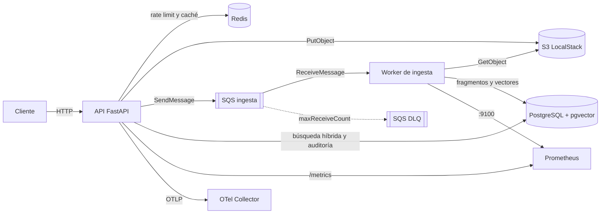
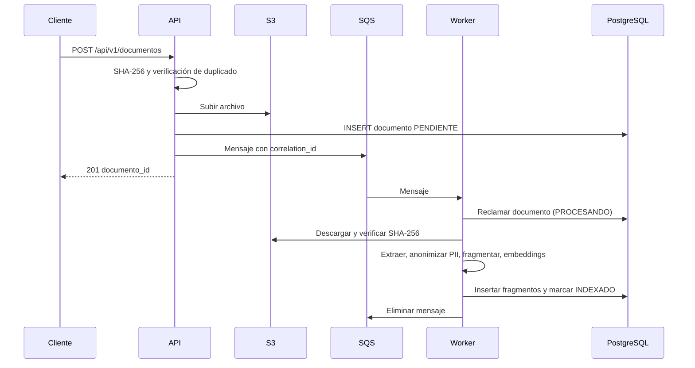
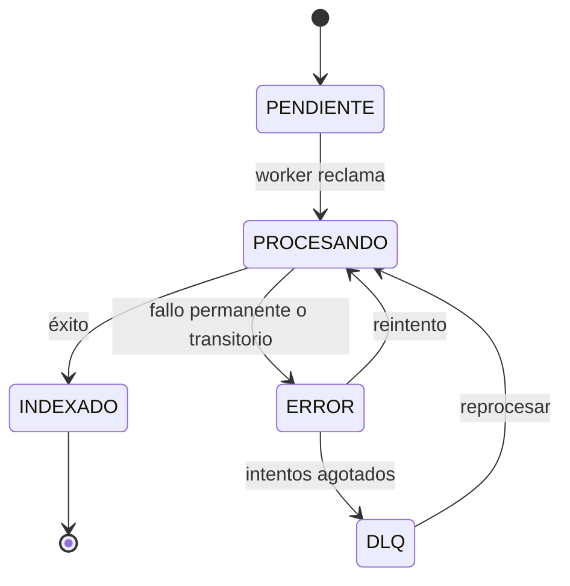

# Arquitectura

## Visión general

## Flujo de ingesta

## Estados del documento

## Consulta RAG

1. La pregunta se anonimiza (RUT con módulo 11, correo, teléfono, tarjeta, cuenta).
2. Se consulta la caché exacta y luego la semántica (similitud coseno sobre el embedding).
3. Sin acierto, la búsqueda híbrida combina similitud `pgvector` (`1 - (embedding <=> vec)`) y `ts_rank_cd` en
   español mediante Reciprocal Rank Fusion ponderada, solo sobre documentos `INDEXADO`.
4. La síntesis extractiva elige la oración más afín de cada fragmento y devuelve citas con
   `documento_id`, `nombre_archivo`, `pagina`, `indice_fragmento`, `score` y `extracto`.
5. Se registra en `auditoria_consultas` y `metricas_finops` (costo estimado: 0 USD).

## Decisiones de diseño

- **Idempotencia**: el worker reclama documentos con `UPDATE ... RETURNING` condicionado al estado; un mensaje
  duplicado se omite y uno atascado en `PROCESANDO` se recupera tras el tiempo de visibilidad.
- **Reintentos**: los errores permanentes no se reintentan; los transitorios usan espera exponencial hasta la DLQ.
- **FinOps**: cada servicio registra consumo en `metricas_finops` con su límite de capa gratuita; el resumen
  compara el costo acumulado con `FINOPS_BUDGET_USD`.
- **Solo lectura**: la imagen no escribe fuera de `/tmp` (latido del worker incluido).

## Operación

| Situación | Acción |
|---|---|
| Documento en `ERROR` o `DLQ` | `python -m reprocesar --simular`, luego sin `--simular`. |
| Mensajes acumulados en la DLQ | Revisar `mensaje_error` del documento, corregir la causa y reprocesar. |
| API degradada (503 en `/health`) | Revisar `componentes` en la respuesta para ubicar el servicio caído. |
| Alertas | Reglas en `monitoring/prometheus/alert-rules.yml` (API caída, 5xx, latencia p95, worker, ingesta). |
